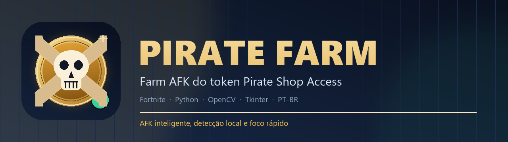
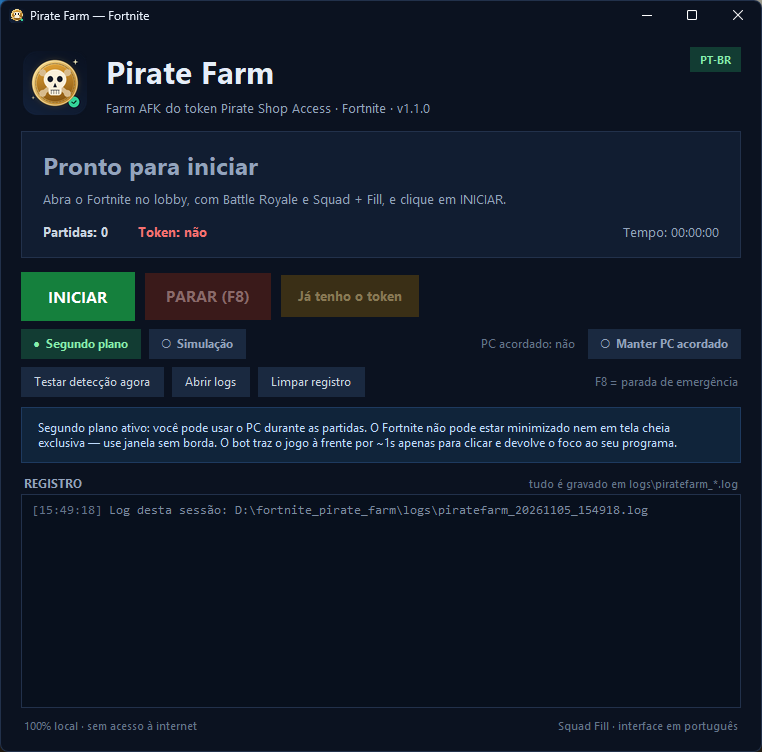

<p align="center">
  
</p>

<h1 align="center">Pirate Farm</h1>

<p align="center">
  Farm AFK do <strong>Pirate Shop Access</strong> no Fortnite, com interface em português,
  captura em segundo plano e detecção local por visão computacional.
</p>

<p align="center">
  <a href="https://www.python.org/"></a>
  <a href="#requisitos"></a>
  <a href="LICENSE"></a>
  <a href="CHANGELOG.md"></a>
  <a href="https://github.com/nvd7/fortnite-pirate-farm/actions/workflows/tests.yml"></a>
  
</p>

<p align="center">
  <a href="#sobre">Sobre</a> ·
  <a href="#recursos">Recursos</a> ·
  <a href="#instalação">Instalação</a> ·
  <a href="#como-usar">Como usar</a> ·
  <a href="#configuração">Configuração</a> ·
  <a href="#solução-de-problemas">Solução de problemas</a>
</p>

<p align="center">
  
</p>

> [!WARNING]
> **Automação pode violar os Termos de Serviço da Epic Games.** Este projeto é
> experimental e não é afiliado à Epic Games. Use apenas em uma conta que você
> aceita o risco de perder. O programa não injeta código no jogo: ele lê o log
> local, captura a tela e envia cliques/teclas como um usuário.

> [!IMPORTANT]
> **Status:** v1.1.2 — pós-partida por clique visual, saída automática quando o
> esquadrão fica vazio e retorno pelo menu **Voltar ao Lobby**. O primeiro farm
> com partidas reais deve ser supervisionado, porque telas de recompensa e
> mudanças de layout do Fortnite podem exigir calibração.

---

## Sobre

O **Pirate Farm** mantém o Fortnite jogando sozinho no modo **Squad + Fill** para
farmar o token **Pirate Shop Access** do evento Treasure Hunters. Como o token é
compartilhado com o esquadrão, seus companheiros podem encontrá-lo enquanto você
fica AFK.

O ciclo é automático:

1. O bot identifica o lobby e clica em **JOGAR**.
2. Entra na partida e fica parado, observando o banner do token.
3. Acompanha os preenchimentos pelo canal de chat do jogo. Se todos saírem (ou
   morrerem) e a partida ficar sem companheiros vivos, abre o menu com **ESC** e
   clica em **Voltar ao Lobby** para procurar outro esquadrão.
4. Ao terminar a partida, clica em **JOGAR NOVAMENTE** na tela de resumo. Se não
   houver esse botão, abre o menu com **ESC** e usa **Voltar ao Lobby**.
5. Quando o token aparece, espera a partida acabar, retorna ao lobby, confirma a
   recompensa com **CLAIM ALL** (se a tela aparecer) e encerra.

A automação é **híbrida**: o `FortniteGame.log` informa em que fase o jogo está;
a visão computacional confirma o botão **JOGAR**, a tela de suspensão, o token e
o botão **CLAIM ALL**. Nada é enviado para a internet.

---

## Recursos

- **Modo segundo plano (padrão):** captura o Fortnite mesmo com outra janela na
  frente, usando `PrintWindow` + `PW_RENDERFULLCONTENT`. Você pode usar o PC
  durante as partidas.
- **Foco rápido:** quando é preciso clicar, o jogo vem para a frente por cerca de
  um segundo e o foco anterior (e a posição do cursor) é restaurado em seguida.
- **Detecção robusta do token:** OpenCV com múltiplas escalas e validação de cor,
  testada contra lobby, desktop, tela de suspensão e imagens de referência.
- **Ciclo por log + visão:** lobby, matchmaking, partida, pós-partida e retorno ao
  lobby sem depender de temporizações fixas.
- **Pós-partida por clique visual:** clica em **JOGAR NOVAMENTE** ou
  **RETORNAR AO LOBBY**; não usa ENTER/ESPAÇO, então o chat do jogo não abre.
- **Saída automática do esquadrão:** quando todos os preenchimentos saem ou não
  há mais companheiros vivos, o bot abre o menu e clica em **Voltar ao Lobby**.
  A saída é cancelada se algum preenchimento voltar e nunca acontece com o token
  encontrado.
- **CLAIM ALL automático** na tela de recompensa do token.
- **Tela de suspensão do Fortnite:** detecta “O FORTNITE ESTÁ NO MODO DE
  SUSPENSÃO” e clica em **CONTINUAR JOGANDO**.
- **Prevenção de suspensão do Windows:** botão **Manter PC acordado** e proteção
  automática enquanto o bot roda.
- **Interface escura em PT-BR**, com status, contadores, log ao vivo e atalho
  global **F8** para parada de emergência.
- **Modo simulação:** acompanha o log e testa a detecção sem clicar no jogo.
- **Diagnóstico local:** capturas em `logs\snapshots\`, log da sessão e arquivo
  `TOKEN_ENCONTRADO.txt` quando o token é detectado.
- **100% local:** sem telemetria, sem login, sem acesso à rede em tempo de
  execução.

---

## Requisitos

| Item | Recomendado |
|---|---|
| Sistema | Windows 10 ou 11, 64 bits |
| Python | **3.11 ou superior** (testado em 3.12 e 3.14) |
| Jogo | Fortnite instalado e conta já logada |
| Modo de vídeo | **Janela sem borda** (windowed fullscreen) |
| Resolução | **1920×1080** como referência (outras resoluções são escaladas) |
| Modo de jogo | Battle Royale com **Squad + Fill (Preencher)** |
| Conta | De preferência uma conta alternativa; veja o aviso no topo |
| Energia | Suspensão do Windows desativada durante o farm |

> [!TIP]
> Para o modo segundo plano ficar fluido, desative nas configurações do Fortnite
> a opção que **suspende o jogo quando ele perde o foco**, se ela existir na sua
> versão. O bot até clica em **CONTINUAR JOGANDO**, mas o jogo suspenso deixa de
> renderizar e a detecção fica mais lenta.

---

## Instalação

### Opção 1 — automática (recomendada)

1. Instale o **Python 3.11+** em [python.org](https://www.python.org/downloads/)
   marcando **“Add python.exe to PATH”**. No Windows 11, também funciona:
   ```powershell
   winget install Python.Python.3.12
   ```
2. Baixe o projeto:
   ```powershell
   git clone https://github.com/nvd7/fortnite-pirate-farm.git
   cd fortnite-pirate-farm
   ```
   Se preferir, use **Code → Download ZIP** no GitHub e extraia a pasta.
3. Dê dois cliques em **`run.bat`**. Na primeira execução ele cria a `.venv` e
   instala as dependências automaticamente. Depois disso, o app abre direto.

Se o Windows bloquear o `.bat`, clique com o botão direito → **Propriedades** →
desmarque **Bloqueado**, ou execute o `run.bat` pelo terminal.

### Opção 2 — manual

```powershell
python -m venv .venv
.venv\Scripts\python.exe -m pip install --upgrade pip
.venv\Scripts\python.exe -m pip install -r requirements.txt
.venv\Scripts\pythonw.exe main.py
```

Para ver o console e mensagens de erro:

```powershell
.venv\Scripts\python.exe main.py
```

Dependências: `opencv-python`, `numpy`, `mss`, `pydirectinput` e `pywin32`.
A internet é usada apenas na instalação; o aplicativo roda offline.

---

## Como usar

### Antes de iniciar

1. Abra o Fortnite e faça login.
2. Selecione **Battle Royale**.
3. Selecione **Squad** e ative **Fill / Preencher**.
4. Deixe o jogo no **lobby**, em **janela sem borda**, e **não minimize**.
5. Feche overlays que possam cobrir a tela do jogo (alguns overlays de captura
   também atrapalham o `PrintWindow`).

### Iniciar o farm

1. Dê dois cliques em **`run.bat`**.
2. Confira se a opção **Segundo plano** está marcada (padrão).
3. Clique em **INICIAR**.
4. Pode usar o computador normalmente. O jogo continuará rodando atrás das
   outras janelas; ele **não pode** ser minimizado.
5. Quando o bot precisar clicar, o Fortnite virá para a frente por ~1 s e depois
   devolverá o foco ao seu programa.
6. Para parar a qualquer momento, pressione **F8** ou clique em **PARAR (F8)**.

> [!NOTE]
> O foco rápido é curto, mas pode interromper uma digitação. Se estiver
> trabalhando, prefira usar outro computador/usuário ou aceite esse pequeno
> roubo de foco.

### Primeiro teste (recomendado)

Antes de deixar o bot sozinho:

1. Marque **Simulação**. Nesse modo o bot não clica nem pressiona teclas.
2. Clique em **INICIAR** e comece uma partida manualmente no Fortnite.
3. Acompanhe o registro: o bot deve identificar lobby, partida e pós-partida.
4. Use **Testar detecção agora** com o jogo no lobby: ele salva
   `logs\teste_tela.png` e informa se encontrou **JOGAR**, a tela de suspensão ou
   o token.
5. Pare com **F8** e faça uma partida real supervisionada, com **Simulação**
   desmarcada.

### Quando o token é encontrado

- O app mostra **“TOKEN ENCONTRADO!”** e toca um alerta.
- O bot espera a partida atual terminar e volta ao lobby.
- Se a tela de recompensa aparecer, ele clica em **CLAIM ALL**.
- O arquivo **`TOKEN_ENCONTRADO.txt`** é criado na pasta do projeto.
- O app fecha sozinho após **30 segundos** (configurável).

Se você já tem o token e o bot está rodando, clique em **“Já tenho o token”**:
ele não inicia outra partida e encerra ao voltar ao lobby.

---

## Modo segundo plano

O modo segundo plano é o padrão e permite usar o PC durante o farm.

| Recurso | Como funciona |
|---|---|
| Captura | `PrintWindow` com `PW_RENDERFULLCONTENT` captura a janela encoberta |
| Foco | O jogo é trazido à frente só para o clique/tecla e o foco anterior é restaurado |
| Cursor | A posição do mouse é salva e devolvida após a ação |
| Limite | A janela **não pode estar minimizada** |
| Limite | **Tela cheia exclusiva** não permite a captura em segundo plano |
| Limite | O jogo precisa continuar renderizando; evite a suspensão do Fortnite |

Se o `PrintWindow` falhar, o bot registra um aviso e tenta novamente. Para voltar
ao modo antigo, desmarque **Segundo plano** na interface — nesse caso, deixe o
Fortnite em primeiro plano e não use o PC durante o farm.

---

## Configuração

As opções ficam em **`config.json`**. A interface salva automaticamente
`background_mode` e `dry_run` quando você clica em **INICIAR**. Coordenadas são
relativas a **1920×1080** e escaladas para o tamanho real da janela.

| Campo | Padrão | Descrição |
|---|---:|---|
| `behavior.background_mode` | `true` | Captura sem roubar o foco e foco rápido para clicar |
| `behavior.dry_run` | `false` | Modo simulação: não clica nem pressiona teclas |
| `behavior.scan_interval_match` | `1.6` | Intervalo (s) entre verificações do token na partida |
| `behavior.max_matches` | `0` | Máximo de partidas; `0` = sem limite |
| `behavior.max_runtime_minutes` | `0` | Tempo máximo em minutos; `0` = sem limite |
| `behavior.auto_close_success_seconds` | `30` | Segundos até fechar após achar o token; `0` = não fecha |
| `behavior.claim_timeout` | `20.0` | Tempo (s) procurando a tela de recompensa |
| `behavior.matchmaking_timeout` | `240.0` | Tempo (s) esperando a partida começar |
| `behavior.postmatch_click_after` | `8.0` | Espera (s) antes de clicar no resumo |
| `behavior.postmatch_click_retry` | `6.0` | Intervalo (s) entre tentativas de clique no resumo |
| `behavior.postmatch_menu_after` | `14.0` | Espera (s) para abrir o menu com ESC quando o resumo não tem botões |
| `behavior.postmatch_timeout` | `180.0` | Tempo (s) máximo nas telas de pós-partida |
| `behavior.squad_leave_delay` | `10.0` | Espera (s) antes de sair quando o esquadrão fica vazio |
| `behavior.squad_leave_retry` | `20.0` | Intervalo (s) entre tentativas de saída |
| `ui.play_button` | `[265, 938]` | Centro do botão JOGAR no lobby |
| `ui.suspend_continue` | `[960, 496]` | Centro de CONTINUAR JOGANDO |
| `ui.claim_button` | `[965, 992]` | Centro do CLAIM ALL |
| `detection.inner_score` | `0.62` | Limiar do template interno do token |
| `detection.inner_score_small` | `0.62` | Limiar para tokens pequenos (banner e ícones) |
| `detection.white_max_inner` | `0.80` | Branco máximo no centro do disco (evita efeitos dourados) |
| `detection.frame_score` | `0.70` | Limiar do quadro dourado do banner |
| `detection.play_again_score` | `0.65` | Limiar do botão JOGAR NOVAMENTE |
| `detection.return_lobby_score` | `0.65` | Limiar do botão RETORNAR AO LOBBY |
| `detection.voltar_lobby_score` | `0.62` | Limiar do botão Voltar ao Lobby no menu |

> [!TIP]
> Para testar com poucas partidas, use `max_matches: 2`. Para limitar o tempo,
> use `max_runtime_minutes: 120`. Depois de editar o arquivo, reinicie o app.

---

## Como funciona

```text
FortniteGame.log ──► lobby / matchmaking / partida / pós-partida
        │
        └── PrintWindow ──► OpenCV ──► token / JOGAR / CONTINUAR / CLAIM ALL
```

A máquina de estados, as threads e o fluxo de decisão estão detalhados em
[docs/ARQUITETURA.md](docs/ARQUITETURA.md).

### Log do Fortnite

O arquivo `%LOCALAPPDATA%\FortniteGame\Saved\Logs\FortniteGame.log` é lido de
forma incremental. Entre os eventos usados:

| Evento | Significado |
|---|---|
| `UI State ... [UI.State.Athena.Frontend]` | lobby |
| `UI State ... [UI.State.Athena.BattleRoyale]` | partida |
| `EAthenaGamePhase::EndGame` | fim da partida |
| `Match State Changed ... WaitingPostMatch/LeavingMap` | tela de pós-partida |
| `WBP_PostMatchPanelContainer` | widget do resumo da partida |
| `OnPlayerPawnDied` | seu personagem morreu |
| `LogSocialChatManager ... Pl:/PlayerAdded/PlayerRemoved` | preenchimentos entram e saem do esquadrão |
| `LogSpectateAfterDeathViewTarget ... No teammates available to follow` | você morreu e não há companheiros vivos |

### Visão computacional

- **`assets/coin_inner.png`** — disco dourado com o “F” branco, usado nas telas
  de recompensa.
- **`assets/coin_banner_frame.png`** — quadro dourado do banner do token.
- **`assets/play_button.png`** e **`assets/suspend_button.png`** — botões do
  lobby e da tela de suspensão.
- **`assets/play_again.png`** e **`assets/return_lobby.png`** — botões do resumo
  da partida (**JOGAR NOVAMENTE** e **RETORNAR AO LOBBY**).
- **`assets/voltar_lobby.png`** — botão **Voltar ao Lobby** do menu de pausa
  novo; **`assets/exit_icon.png`** mantém o fluxo da interface antiga como
  fallback.

Cada acerto é validado por proporção de dourado e presença de branco no centro,
o que reduz falsos positivos no lobby e no desktop.

### Entrada

- Cliques: `SetCursorPos` + `mouse_event`.
- Foco: `SetForegroundWindow` com fallback por `AttachThreadInput`.
- Teclas: `pydirectinput` (SendInput).
- F8: `RegisterHotKey`, sem hooks globais de teclado.
- Suspensão do Windows: `SetThreadExecutionState` em um worker dedicado.

---

## Testes

O autoteste não abre o jogo nem clica em nada:

```powershell
.venv\Scripts\python.exe selftest.py
```

Para validar também a captura ao vivo (Fortnite aberto, sem focar o jogo):

```powershell
.venv\Scripts\python.exe selftest.py --live
```

O teste cobre templates do token, imagens negativas, botões JOGAR/CONTINUAR,
pós-partida por clique visual, menu **Voltar ao Lobby**, rastreamento dos
preenchimentos, captura em segundo plano, prevenção de suspensão e o parser do
log real. São 72 verificações offline; o workflow de CI roda a compilação e o
autoteste no Windows.

Para diagnosticar o resumo da partida ou o menu de pausa sem clicar no jogo:

```powershell
.venv\Scripts\python.exe tools\check_postmatch.py
```

O script mostra a confiança de cada template e salva
`logs\diagnostico_pos_partida.png`. Os fluxos que dependem da tela real estão
no [guia de validação supervisionada](docs/VALIDACAO.md).

---

## Estrutura do projeto

```text
fortnite_pirate_farm/
├── main.py                     # interface Tkinter em modo escuro
├── selftest.py                 # testes offline e ao vivo
├── config.json                 # coordenadas e comportamento
├── run.bat                     # instala e abre o app sem console
├── run_debug.bat               # abre com console para diagnóstico
├── piratebot/
│   ├── bot.py                  # máquina de estados do farm
│   ├── config.py               # leitura/gravação da configuração
│   ├── controller.py           # foco rápido, cliques e teclas
│   ├── hotkey.py               # atalho global F8
│   ├── logwatcher.py           # leitura incremental do log
│   ├── power.py                # prevenção de suspensão do Windows
│   ├── squad.py                # rastreamento dos preenchimentos
│   └── vision.py               # PrintWindow, templates e OpenCV
├── assets/
│   ├── logo.png                # identidade visual
│   ├── coin_inner.png
│   ├── coin_banner_frame.png
│   ├── play_button.png
│   ├── suspend_button.png
│   ├── play_again.png
│   ├── return_lobby.png
│   ├── voltar_lobby.png
│   ├── exit_icon.png
│   └── test/                   # imagens de referência do autoteste
├── docs/
│   ├── banner.png
│   ├── screenshot.png
│   ├── social_preview.png
│   ├── ARQUITETURA.md          # máquina de estados e componentes
│   ├── CALIBRAGEM.md           # recaptura e validação de templates
│   ├── VALIDACAO.md            # roteiro de teste supervisionado
│   └── RELEASE.md              # checklist de publicação
├── tools/
│   ├── make_branding.py        # gera logo/banner (requer Pillow)
│   ├── check_bg_capture.py     # diagnóstico da captura em segundo plano
│   └── check_postmatch.py      # diagnose visual do resumo (não clica)
├── .github/workflows/tests.yml # CI de compilação e autoteste
└── logs/                       # criado em tempo de execução
```

---

## Solução de problemas

| Problema | O que fazer |
|---|---|
| **“Janela do Fortnite não encontrada”** | Abra o Fortnite, use janela sem borda e não minimize. Verifique se o título da janela contém `Fortnite`. |
| **“Falha na captura em segundo plano”** | Confirme que o jogo não está minimizado, desative tela cheia exclusiva e a suspensão do Fortnite. Teste **Testar detecção agora**. |
| **O bot não clica em JOGAR** | Use **Testar detecção agora** e veja `logs\teste_tela.png`. Confirme o lobby, o modo Battle Royale e o Squad + Fill. |
| **Token não detectado** | Veja as capturas em `logs\snapshots\`. Atualizações do jogo podem mudar a arte; siga o [guia de calibragem](docs/CALIBRAGEM.md) para recapturar o template. |
| **O jogo entra em suspensão** | O bot tenta **CONTINUAR JOGANDO**, mas o ideal é desativar a suspensão nas configurações do Fortnite e manter a janela sem borda. |
| **O PC dorme ou a tela bloqueia** | Ative **Manter PC acordado** e desative a suspensão/bloqueio automático no Windows. `Win+L` manual não é impedido. |
| **A tela de pós-partida não avança** | Confira as capturas `logs\snapshots\pos_partida_*.png`. Ajuste `postmatch_click_after`/`postmatch_click_retry` e, se o resumo não tiver botões, `postmatch_menu_after`. |
| **Não sei qual botão o resumo exibe** | Rode `tools\check_postmatch.py` e veja a confiança de cada template. O diagnóstico não clica no jogo. |
| **Falso positivo de token** | Guarde a captura de `logs\snapshots\` e abra uma issue; não aumente o limiar sem testar as imagens negativas. |
| **Python não encontrado no `run.bat`** | Reinstale o Python marcando **Add python.exe to PATH** e abra um terminal novo. |
| **O app não abre** | Execute `run_debug.bat` e observe o console. Envie o erro junto com a versão do Windows/Python. |

---

## Limitações e avisos

- **Somente Windows.** A captura, o foco e os cliques usam APIs nativas do
  Windows.
- **Calibrado em 1920×1080 e interface PT-BR.** Outras resoluções e idiomas podem
  exigir ajustes nos templates/coordenadas.
- **A primeira partida real deve ser supervisionada.** A tela de recompensa e o
  CLAIM ALL ainda podem variar conforme o evento/atualização.
- **Não minimize o Fortnite** e não use tela cheia exclusiva no modo segundo
  plano.
- **Atualizações do Fortnite podem quebrar a detecção.** O projeto é
  experimental e não tem vínculo com a Epic Games.
- **Risco de conta:** automação pode violar os Termos de Serviço. Você é
  responsável pelo uso e por qualquer consequência na sua conta.
- **Sem garantias.** O software é fornecido sob a licença MIT, sem garantia de
  funcionamento ou de obtenção do token.

---

## Privacidade

O aplicativo **não acessa a internet** durante a execução. Ele lê apenas o log
local do Fortnite, captura a janela do jogo e grava logs/capturas na pasta do
projeto. Nenhuma credencial é solicitada ou armazenada. As imagens de badge do
README são carregadas pelo GitHub, não pelo aplicativo.

---

## Contribuindo

Ideias, correções e novos templates são bem-vindos. Leia
[CONTRIBUTING.md](CONTRIBUTING.md) antes de abrir uma issue ou pull request.
Inclua o resultado do `selftest.py`, a resolução do jogo e, quando for um
problema visual, uma captura sem dados pessoais. Quem for publicar uma versão
deve seguir o [checklist de release](docs/RELEASE.md).

---

## Licença

Distribuído sob a licença [MIT](LICENSE). Copyright © 2026 nvd7.

**Pirate Farm não é afiliado, associado ou endossado pela Epic Games.** Fortnite
é uma marca registrada da Epic Games, Inc.
