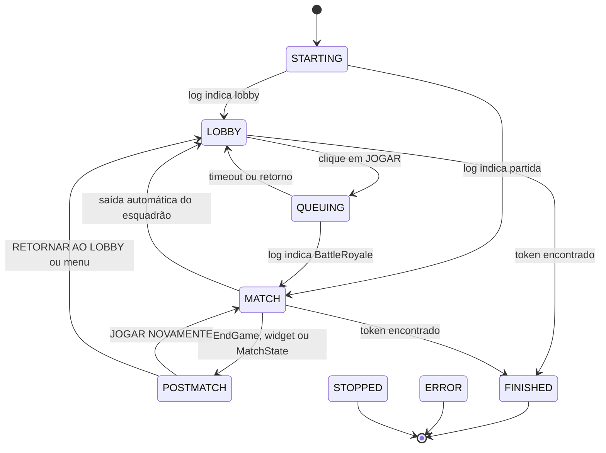

# Arquitetura

O Pirate Farm é um aplicativo local para Windows que mantém o Fortnite em
partidas de Battle Royale em Squad + Fill, sem interação manual, até encontrar
o token do Pirate Shop Access. Esta página descreve como as peças se conectam
e quais decisões guiam o comportamento do bot.

## Princípios

- **O log é a fonte de verdade do ciclo.** `FortniteGame.log` informa lobby,
  partida, fim de jogo, morte e movimento dos preenchimentos.
- **A imagem só decide o que o log não vê.** OpenCV encontra o token, o resumo
  e os botões; nenhuma leitura de memória ou injeção no jogo é usada.
- **O jogo não é sequestrado.** No modo segundo plano a captura usa
  `PrintWindow`; o foco é solicitado por cerca de um segundo apenas para
  clicar ou pressionar uma tecla.
- **Toda ação é reversível e observável.** O app registra cada transição,
  salva capturas de diagnóstico e pode rodar em simulação (`dry_run`).

## Componentes

| Arquivo | Responsabilidade |
|---|---|
| `main.py` | Interface Tkinter, tema escuro, atalho F8, fila de mensagens da UI e ciclo de vida do bot. |
| `piratebot/bot.py` | Máquina de estados, regras de permanência/saída, pós-partida e arquivo de sucesso. |
| `piratebot/logwatcher.py` | Leitura incremental do log e conversão de linhas em `LogEvent`. |
| `piratebot/squad.py` | Rastreamento dos preenchimentos por conversa de chat. |
| `piratebot/vision.py` | Captura da janela, templates, validação de cor e localização de botões. |
| `piratebot/controller.py` | Foco rápido, cliques e teclas com escala de coordenadas. |
| `piratebot/config.py` | Dataclasses, valores padrão e leitura/gravação do `config.json`. |
| `piratebot/power.py` | Prevenção de suspensão do Windows em worker dedicado. |
| `piratebot/hotkey.py` | Registro global do F8 via `RegisterHotKey`. |
| `tools/check_postmatch.py` | Diagnóstico visual sem cliques para o resumo e o menu de pausa. |
| `selftest.py` | Verificações offline e teste ao vivo opcional. |

## Fluxo principal



### Lobby

`_do_lobby` espera `ready_delay`, confere a tela e clica em **JOGAR**. Se o
jogo estiver suspenso, tenta **CONTINUAR JOGANDO** antes. Um clique efetivo
leva a `QUEUING`; se o log não confirmar a partida dentro de
`matchmaking_timeout`, o bot volta ao lobby e tenta de novo.

### Partida

Em `MATCH` o bot fica AFK. A cada `scan_interval_match` ele captura a tela e
procura o token. O log pode encerrar a partida por três caminhos: fase
`EndGame`, widget de pós-partida ou `MatchState` `WaitingPostMatch`/`LeavingMap`.
Todos levam a `POSTMATCH`.

### Pós-partida

`_do_postmatch` procura primeiro o token na tela de recompensa. Depois escolhe
o botão:

1. Se o token foi encontrado ou o limite de partidas foi atingido, procura
   **RETORNAR AO LOBBY**.
2. Caso contrário, procura **JOGAR NOVAMENTE** e, em seguida,
   **RETORNAR AO LOBBY**. Depois do clique em **JOGAR NOVAMENTE**, o bot fica
   na tela de fila e só volta ao fluxo de saída se `matchmaking_timeout`
   estourar; nesse intervalo ele não pressiona **ESC**.
3. Se nenhum botão existir, procura **Voltar ao Lobby** ou a aba de opções no
   painel já aberto.
4. Se o painel ainda não estiver aberto, pressiona **ESC** após
   `postmatch_menu_after`; se a aba de opções aparecer, clica nela antes de
   procurar o botão.

Esse último caminho cobre o caso em que o jogador local é o último
sobrevivente e o resumo não oferece botões. O bot nunca usa ENTER ou ESPAÇO
para avançar telas.

### Retorno ao lobby

`_returned_to_lobby` zera o rastreamento do esquadrão e decide o próximo passo:

- token encontrado: procura **CLAIM ALL**, grava `TOKEN_ENCONTRADO.txt` e
  encerra após `auto_close_success_seconds`;
- limite de partidas atingido: para sem token;
- caso contrário: volta para `LOBBY` e reenfileira.

## Preenchimentos (fills)

`SquadTracker` acompanha o canal `ChannelName:BR.Any...` do chat. Eventos
`PlayerAdded:MCP:` entram na lista e `PlayerRemoved:MCP:` saem. O jogador
local é identificado por `SetHasFinishedLoading` e nunca conta como fill.

Quando o último fill sai e o chat confirma o esquadrão vazio, o bot agenda uma
saída para `squad_leave_delay` segundos depois. O evento
`No teammates available to follow` pode aparecer mesmo com fills vivos, então
não agenda a saída sozinho: ele só reforça a decisão quando o rastreador já
está vazio. Se alguém voltar antes do clique, a saída é cancelada. Se o token
já foi encontrado, nenhuma saída automática é agendada.

## Captura e visão computacional

O fluxo de captura é:

1. localizar a janela pelo título configurado;
2. capturar com `PrintWindow` + `PW_RENDERFULLCONTENT` no modo segundo plano,
   ou pela tela no modo primeiro plano;
3. reduzir a imagem para `downscale_width` antes da busca;
4. comparar templates em várias escalas;
5. validar cor (ouro e branco) e aplicar supressão de não máximos.

O token é procurado em duas formas: disco dourado com "F" (recompensa) e
quadro dourado do banner (durante a partida). Os botões usam templates
próprios: `play_button.png`, `suspend_button.png`, `play_again.png`,
`return_lobby.png`, `voltar_lobby.png`, `menu_tab.png` (aba de opções do painel
social) e o fallback `exit_icon.png`.

## Threads e comunicação

| Thread | Papel |
|---|---|
| Thread principal | Loop do Tkinter, eventos de interface e atalho F8. |
| Worker do bot | `_run`: configuração, loop de estados e limpeza. |
| `LogWatcher` | Lê o log incrementalmente e publica `LogEvent` na fila. |
| Worker de energia | Mantém `SetThreadExecutionState` enquanto o bot ou o usuário pedirem. |
| Teste de detecção | Captura e análise sob demanda, sem bloquear a janela. |

A UI nunca é alterada diretamente pelo worker: mensagens passam por
`ui_queue` e são consumidas por `_poll`. `stop_event` interrompe o bot e o
watcher; `manual_token` registra o token marcado pelo usuário.

## Configuração

`config.json` é dividido em quatro blocos:

- `game`: título da janela, caminho do log e resolução de referência;
- `ui`: coordenadas de botões fixos (JOGAR, CONTINUAR, CLAIM ALL);
- `detection`: limiares de template e validação de cor;
- `behavior`: tempos, limites, simulação e modo segundo plano.

Coordenadas são sempre relativas a 1920×1080 e escaladas para o tamanho real
do cliente do jogo. Alterações em `behavior` ou `detection` exigem reiniciar
o app.

## Testes e diagnóstico

`selftest.py` cobre templates, imagens negativas, botões, pós-partida, menu,
fills, parser do log, captura em segundo plano e prevenção de suspensão. O
teste ao vivo (`--live`) só captura a tela; ele não clica nem rouba o foco.

Para investigar uma falha visual, use:

```powershell
.venv\Scripts\python.exe tools\check_postmatch.py --json
```

O script salva `logs\diagnostico_pos_partida.png` e mostra a confiança de cada
template sem interagir com o jogo.

## Limitações conhecidas

- Templates e coordenadas dependem da interface PT-BR em 1920×1080.
- O modo segundo plano exige janela sem borda e não minimizada.
- A tela de recompensa e o CLAIM ALL podem variar entre eventos.
- A primeira partida real e o caso de último sobrevivente devem ser
  supervisionados; veja [VALIDACAO.md](VALIDACAO.md).
