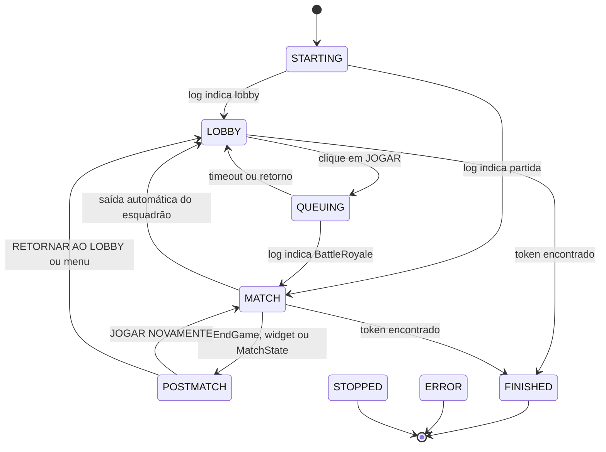

# Arquitetura

O Pirate Farm é um aplicativo local para Windows que mantém o Fortnite em
partidas de Battle Royale em Squad + Fill, sem interação manual, até encontrar
o token do Pirate Shop Access. Esta página descreve como as peças se conectam
e quais decisões guiam o comportamento do bot.

## Princípios

- **O log é a fonte de verdade do ciclo.** `FortniteGame.log` informa lobby,
  partida, fim de jogo, morte e movimento dos preenchimentos.
- **A imagem só decide o que o log não vê.** OpenCV encontra o token, o resumo
  e os botões; nenhuma leitura de memória ou injeção no jogo é usada.
- **O jogo não é sequestrado.** No modo segundo plano a captura usa
  `PrintWindow`; o foco é solicitado por cerca de um segundo apenas para
  clicar ou pressionar uma tecla.
- **Toda ação é reversível e observável.** O app registra cada transição,
  salva capturas de diagnóstico e pode rodar em simulação (`dry_run`).

## Componentes

| Arquivo | Responsabilidade |
|---|---|
| `main.py` | Interface Tkinter, tema escuro, atalho F8, fila de mensagens da UI e ciclo de vida do bot. |
| `piratebot/bot.py` | Máquina de estados, regras de permanência/saída, pós-partida e arquivo de sucesso. |
| `piratebot/logwatcher.py` | Leitura incremental do log e conversão de linhas em `LogEvent`. |
| `piratebot/squad.py` | Rastreamento dos preenchimentos por conversa de chat. |
| `piratebot/vision.py` | Captura da janela, templates, validação de cor e localização de botões. |
| `piratebot/controller.py` | Foco rápido, cliques e teclas com escala de coordenadas. |
| `piratebot/config.py` | Dataclasses, valores padrão e leitura/gravação do `config.json`. |
| `piratebot/power.py` | Prevenção de suspensão do Windows em worker dedicado. |
| `piratebot/presence.py` | Tempo desde o último teclado/mouse e detecção de sessão bloqueada. |
| `piratebot/hotkey.py` | Registro global do F8 via `RegisterHotKey`. |
| `piratebot/rewards.py` | OCR do banner, parser de nomes (PT/EN/AR), deduplicação e brasão dourado. |
| `piratebot/retention.py` | Limpeza de capturas por quantidade/idade, com proteção das evidências do token. |
| `piratebot/webhook.py` | Fila em segundo plano e envio multipart para Discord ou endpoint genérico. |
| `tools/instalar.ps1` | Instalação do Python/.venv/dependências e criação do atalho. |
| `tools/check_postmatch.py` | Diagnóstico visual sem cliques para o resumo e o menu de pausa. |
| `selftest.py` | Verificações offline e teste ao vivo opcional. |

## Fluxo principal



### Lobby

`_do_lobby` espera `ready_delay`, confere a tela e clica em **JOGAR**. Se a
tela **“AINDA ESTÁ AÍ?”** aparecer, o padrão é encerrar a sessão por segurança,
sem clicar em **CONTINUAR JOGANDO**. O clique legado só ocorre se
`stop_on_afk_warning` for desativado. Um clique efetivo leva a `QUEUING`; se o
log não confirmar a partida dentro de `matchmaking_timeout`, o bot volta ao
lobby e tenta de novo.

### Partida

Em `MATCH` o bot fica AFK. A cada `scan_interval_match` ele captura a tela,
procura o token e verifica avisos de presença/AFK. O log pode encerrar a
partida por três caminhos: fase `EndGame`, widget de pós-partida ou `MatchState`
`WaitingPostMatch`/`LeavingMap`. Todos levam a `POSTMATCH`.

### Proteção de presença e AFK

O loop principal chama `presence` a cada 10 segundos. Se
`idle_stop_minutes` for maior que zero e `GetLastInputInfo` indicar que o
teclado/mouse estão parados além do limite, ou se `OpenInputDesktop` indicar
que a sessão do Windows está bloqueada, o bot registra o resumo da sessão e
para. Não há movimento, tecla ou clique simulando presença.

Durante `MATCH`, `LOBBY` e `POSTMATCH`, `RewardScanner.check_afk_warning` faz
uma leitura OCR completa da região central a cada 6 segundos. O parser
`is_afk_warning` reconhece mensagens como **“AINDA ESTÁ AÍ?”**, “removido por
inatividade”, “removed for inactivity” e equivalentes em árabe. Se encontrar o
aviso, o bot salva a captura `aviso_afk_*` e encerra sem tentar continuar a
partida.

O detector visual da tela **“AINDA ESTÁ AÍ?”** também para a sessão quando
`stop_on_afk_warning` está ativo. Com a opção desativada, o comportamento antigo
(clicar em **CONTINUAR JOGANDO**) é preservado apenas para compatibilidade e é
explicitamente desencorajado na interface e na documentação.

### Pós-partida

`_do_postmatch` procura primeiro o token na tela de recompensa. Depois escolhe
o botão:

1. Se o token foi encontrado ou o limite de partidas foi atingido, procura
   **RETORNAR AO LOBBY**.
2. Caso contrário, procura **JOGAR NOVAMENTE** e, em seguida,
   **RETORNAR AO LOBBY**. Depois do clique em **JOGAR NOVAMENTE**, o bot fica
   na tela de fila e só volta ao fluxo de saída se `matchmaking_timeout`
   estourar; nesse intervalo ele não pressiona **ESC**.
3. Se nenhum botão existir, procura **Voltar ao Lobby** ou a aba de opções no
   painel já aberto.
4. Se o painel ainda não estiver aberto, pressiona **ESC** após
   `postmatch_menu_after`; se a aba de opções aparecer, clica nela antes de
   procurar o botão.

Esse último caminho cobre o caso em que o jogador local é o último
sobrevivente e o resumo não oferece botões. O bot nunca usa ENTER ou ESPAÇO
para avançar telas.

### Retorno ao lobby

`_returned_to_lobby` zera o rastreamento do esquadrão e decide o próximo passo:

- token encontrado: procura **CLAIM ALL**, grava `TOKEN_ENCONTRADO.txt` e
  encerra após `auto_close_success_seconds`;
- limite de partidas ou `max_runtime_minutes` atingido: para sem token;
- caso contrário: volta para `LOBBY` e reenfileira.

O limite de execução é conferido no início de cada ciclo do loop principal.
Ao atingir o valor, o bot para de automatizar sem sair da partida à força e
mostra o motivo no registro. O padrão é de 180 minutos; `0` desativa o limite,
mas aumenta a exposição a bans por AFK.

## Recompensas e webhook

Em `MATCH` e `POSTMATCH`, cada varredura chama `RewardScanner.scan`:

1. `banner_score` mede a faixa clara/dourada central (diagnóstico).
2. `ChestPrecue` compara o dourado da região central com a captura anterior.
   Um clarão forte reduz o intervalo de varredura por alguns segundos. O sinal
   **não confirma o token**: baús e recompensas comuns também podem brilhar.
3. O OCR do Windows lê a região central e devolve as linhas com a posição
   horizontal.
4. As linhas distantes do cabeçalho (`VOCÊ ENCONTROU`, `YOU FOUND`, `عثرت`) ou
   do centro são descartadas; o parser junta nomes de duas ou três linhas e
   remove quantidades/pontuação coladas pelo OCR no fim do nome.
5. Se o texto não produzir um nome, `reward_badge_score` confere o brasão
   dourado (faixa central + ícone emoldurado acima). Se ele existir, tenta um
   segundo OCR com recorte fechado e, por fim, usa o rótulo genérico.
6. `RewardGate` evita repetir a mesma recompensa em `cooldown_seconds` e o
   token em `token_cooldown_seconds`.

`_handle_reward` salva a captura, incrementa o contador, marca `token_found`
quando o nome é o token e enfileira a mensagem no webhook. A imagem é
codificada em PNG na memória antes do envio, então a limpeza de capturas não
interfere em uploads em andamento. A fila e o worker do webhook vivem em
`WebhookNotifier`; `reload_webhook` reinicia o worker quando a URL muda.

## Limpeza de capturas

`prune_snapshots` ordena as capturas por data e:

- preserva `token_*` e `tela_recompensa_*` (evidências);
- preserva as `snapshot_min_keep` mais recentes e arquivos dentro da carência;
- remove por idade e, se ainda houver excesso, as mais antigas até
  `snapshot_max_files`.

A limpeza roda na inicialização, a cada `prune_interval_seconds` e no
encerramento. Os banners `reward_*` são descartáveis; as capturas de token não.

## Preenchimentos (fills)

`SquadTracker` acompanha o canal `ChannelName:BR.Any...` do chat. Eventos
`PlayerAdded:MCP:` entram na lista e `PlayerRemoved:MCP:` saem. O jogador
local é identificado por `SetHasFinishedLoading` e nunca conta como fill.

Quando o último fill sai e o chat confirma o esquadrão vazio, o bot agenda uma
saída para `squad_leave_delay` segundos depois. O evento
`No teammates available to follow` pode aparecer mesmo com fills vivos, então
não agenda a saída sozinho: ele só reforça a decisão quando o rastreador já
está vazio. Se alguém voltar antes do clique, a saída é cancelada. Se o token
já foi encontrado, nenhuma saída automática é agendada.

## Captura e visão computacional

O fluxo de captura é:

1. localizar a janela pelo título configurado;
2. capturar com `PrintWindow` + `PW_RENDERFULLCONTENT` no modo segundo plano,
   ou pela tela no modo primeiro plano;
3. reduzir a imagem para `downscale_width` antes da busca;
4. comparar templates em várias escalas;
5. validar cor (ouro e branco) e aplicar supressão de não máximos.

O token é procurado em duas formas: disco dourado com "F" (recompensa) e
quadro dourado do banner (durante a partida). Os botões usam templates
próprios: `play_button.png`, `suspend_button.png`, `play_again.png`,
`return_lobby.png`, `voltar_lobby.png`, `menu_tab.png` (aba de opções do painel
social) e o fallback `exit_icon.png`.

## Threads e comunicação

| Thread | Papel |
|---|---|
| Thread principal | Loop do Tkinter, eventos de interface e atalho F8. |
| Worker do bot | `_run`: configuração, loop de estados e limpeza. |
| `LogWatcher` | Lê o log incrementalmente e publica `LogEvent` na fila. |
| Worker de energia | Mantém `SetThreadExecutionState` enquanto o bot ou o usuário pedirem. |
| Worker do webhook | Consome a fila e envia capturas/nomes sem bloquear o loop do bot. |
| Teste de detecção | Captura e análise sob demanda, sem bloquear a janela. |

A UI nunca é alterada diretamente pelo worker: mensagens passam por
`ui_queue` e são consumidas por `_poll`. `stop_event` interrompe o bot e o
watcher; `manual_token` registra o token marcado pelo usuário.

## Configuração

`config.json` é dividido em sete blocos:

- `game`: título da janela, caminho do log e resolução de referência;
- `ui`: coordenadas de botões fixos (JOGAR, CONTINUAR, CLAIM ALL);
- `detection`: limiares de template, validação de cor e faixa aceita para o
  centro do token;
- `behavior`: tempos, limites, proteção de inatividade/AFK, simulação e modo
  segundo plano;
- `rewards`: OCR, intervalo de varredura, cooldowns e fallback do brasão;
- `storage`: limites e carência da limpeza de capturas;
- `webhook`: ativação, URL, filtros e fila de envio.

Coordenadas são sempre relativas a 1920×1080 e escaladas para o tamanho real
do cliente do jogo. Alterações em `behavior`, `detection`, `rewards` ou
`storage` exigem reiniciar o app. A URL do webhook pode ser alterada pela aba
**Webhook** e é aplicada imediatamente.

## Testes e diagnóstico

`selftest.py` cobre templates, imagens negativas, botões, pós-partida, menu,
fills, parser do log, captura em segundo plano, prevenção de suspensão, OCR e
parser de recompensas em três idiomas, brasão dourado, deduplicação, retenção
de capturas, payloads de webhook, um envio HTTP local e a proteção de
presença/AFK (`idle_limit_reached`, `is_afk_warning` e leitura OCR completa). O
teste ao vivo (`--live`) só captura a tela; ele não clica nem rouba o foco.

Para investigar uma falha visual, use:

```powershell
.venv\Scripts\python.exe tools\check_postmatch.py --json
```

O script salva `logs\diagnostico_pos_partida.png` e mostra a confiança de cada
template sem interagir com o jogo.

## Limitações conhecidas

- Templates e coordenadas dependem da interface PT-BR em 1920×1080.
- O OCR usa o idioma instalado no Windows; em árabe, sem o pacote de idioma, o
  banner ainda é enviado pelo brasão, mas com o nome genérico.
- O modo segundo plano exige janela sem borda e não minimizada.
- Não há movimento ou check-in automático para burlar AFK. Avisos de presença
  encerram a sessão por segurança.
- A tela de recompensa e o CLAIM ALL podem variar entre eventos.
- A primeira partida real e o caso de último sobrevivente devem ser
  supervisionados; veja [VALIDACAO.md](VALIDACAO.md).
